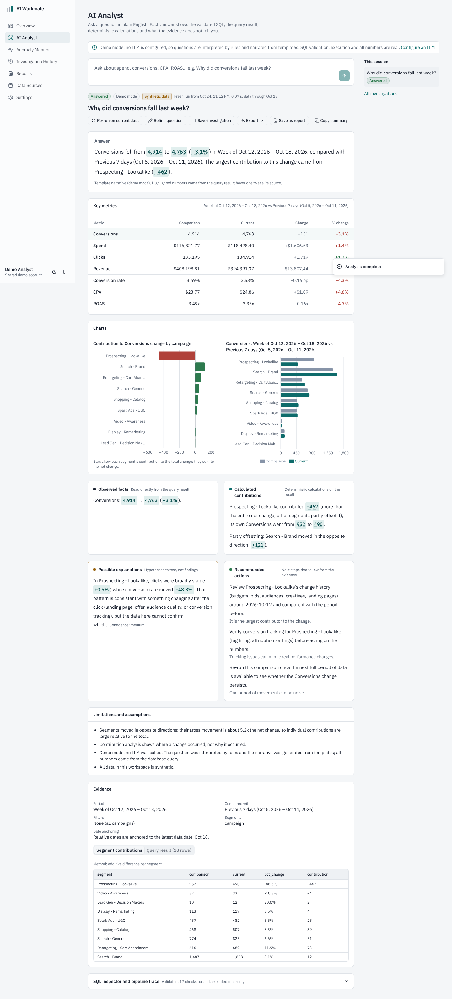

# AI Workmate

**From raw data to clear answers and better decisions.**

AI Workmate is a working analytics app: ask a question about marketing performance in plain English and get an answer whose every number traces back to a validated, read-only database query. It shows the SQL, the result rows, the deterministic calculations, segment contributions, charts, and — just as prominently — what the evidence does *not* tell you.



> **All data in this repository is synthetic.** It is generated deterministically (seed `20261018`) and contains labelled ground-truth scenarios. No real advertiser or employer data is used.

## What it does

| | |
|---|---|
| **AI Analyst** | Natural-language questions → structured plan → SQL → AST validation → read-only execution → deterministic metrics → explanation in which every number is a *fact chip* linked to a computed fact. |
| **Safe text-to-SQL** | `sqlglot` AST validator (single SELECT, allowlisted tables/columns/functions, no catalogs, enforced LIMIT), a least-privilege Postgres role with row-level security, statement timeouts, an independent totals cross-check and a bounded repair loop. Prompts are never the security boundary. |
| **Analytics engine** | Ratio-of-sums metrics (never averages of daily ratios), explicit zero/missing handling, equal-length comparison periods, and an exact LMDI contribution decomposition for ratio metrics. |
| **Anomaly Monitor** | Robust z-scores against a 28-day, day-of-week-adjusted baseline with minimum sample sizes, tracking-gap and missing-data detection, per-user triage states. |
| **History & reports** | Every investigation is persisted (SQL, result, explanation, limitations, timing). Re-run on current data, save, export Markdown/PDF, daily briefing. |
| **Data sources** | Seeded synthetic dataset, CSV upload with mapping, type/duplicate/missing-value checks, formula-injection neutralisation, timezone-aware timestamp conversion. Private per user. |
| **Demo mode** | Without an LLM key the app still works end-to-end using a rule-based interpreter and template narrative, and says so everywhere. It never pretends an LLM was called. |

## Quick start (Docker)

```bash
cp .env.example .env        # then edit the passwords and JWT_SECRET
docker compose up --build
```

Open http://localhost:3000 and choose **Continue with demo account**. The API is on http://localhost:8000 (`/docs` for OpenAPI). On first start the API container creates the roles, applies migrations and loads the synthetic dataset (`SEED_ON_START=true`).

## Local development (no Docker)

Prerequisites: Python 3.13, Node 22, PostgreSQL 16.

```bash
# 1. Backend
cd backend
python -m venv .venv && . .venv/bin/activate
pip install -r requirements-dev.txt
cp .env.example .env                 # set ADMIN_DATABASE_URL to a superuser and choose role passwords
python -m scripts.bootstrap_db       # creates DB, workmate_app + workmate_reader roles, migrations, grants, RLS
python -m seed.load                  # loads SYNTHETIC data + demo account, runs anomaly detection
uvicorn app.main:app --reload --port 8000

# 2. Frontend (new terminal)
cd frontend
npm ci
npm run dev                          # http://localhost:3000 ; /api is proxied to API_URL (default http://localhost:8000)
```

### Configure an LLM provider

Keys live only in the backend environment; the browser never sees them.

```bash
LLM_PROVIDER=anthropic     # or openai (any OpenAI-compatible endpoint via LLM_BASE_URL)
LLM_API_KEY=...
LLM_MODEL=claude-sonnet-4-5   # optional; any model your key can access
```

Restart the API. **Settings → AI model** shows which mode is active. With no key the app runs in clearly labelled demo mode.

## Tests

```bash
cd backend && python -m pytest -q          # 151 tests: unit + integration against real Postgres (creates workmate_test)
cd frontend && npm test                    # Vitest unit tests
cd frontend && npm run lint && npm run typecheck
# End-to-end (API on :8000 and web on :3000 must be running, DB seeded):
cd frontend && npx playwright install chromium && npx playwright test
```

The e2e suite runs the full workflow: open dashboard → ask why conversions declined → verify SQL validation and returned rows → check the chart and explanation agree with the stored query result → save → reopen from history → export Markdown and PDF. It also checks an unsafe prompt is rejected and anomaly triage persists.

## Evaluation

```bash
cd backend && python -m eval.run_eval      # writes eval/results/latest_<mode>.json and EVAL_REPORT_<mode>.md
```

77 questions (aggregations, comparisons, group-bys, ratios, driver analysis, trends, zero denominators, missing data, anomalies, ambiguous, unanswerable, unsafe, plus 10 held-out paraphrases) scored against an **independent pandas oracle**, a 30-query SQL attack corpus, and anomaly precision/recall against ground truth. Latest measured results (demo mode, no LLM): see [docs/EVALUATION_RESULTS.md](docs/EVALUATION_RESULTS.md). LLM-mode results have **not** been measured yet — that needs an API key.

## Repository layout

```
backend/
  app/            FastAPI app: analytics/ (metrics, periods, contribution, anomalies), sqlsafe/ (catalog,
                  validator, executor), pipeline/ (plan, demo planner, SQL builder, compute, explain, narrate,
                  orchestrator), llm/ (provider abstraction, prompts), routers/, services/, security/, connectors/
  migrations/     SQL migrations (schemas, RLS, least-privilege grants)
  seed/           Synthetic data generator, loader, generated CSVs, ground_truth.json
  eval/           benchmark.json, run_eval.py, examples.py, results/
  tests/          pytest suite
frontend/         Next.js 16 + TypeScript + Tailwind v4 + shadcn/ui (Base UI) + Recharts; Vitest + Playwright
docs/             PRD, personas, flows, metric dictionary, architecture, API, security, testing, evaluation,
                  roadmap, trade-offs, case-study template, example answers, screenshots + demo recording
.github/workflows/ci.yml
docker-compose.yml
```

## Troubleshooting

| Symptom | Fix |
|---|---|
| `/health` shows `app_db: false` or "password authentication failed" | Role passwords in `.env` changed after bootstrap. Re-run `python -m scripts.bootstrap_db` (it resets role passwords from `APP_DATABASE_URL` / `READONLY_DATABASE_URL`). |
| Tests clobber the dev database passwords | They don't: tests use database `workmate_test` and reuse the role passwords from your environment/`.env`. If you changed them, re-run bootstrap. |
| Overview says "Data through Oct 18 (N days old)" | Expected: the synthetic data ends 2026-10-18. Relative ranges ("last week") are anchored to the latest data date. |
| "Demo mode" banner | No LLM key configured. Set `LLM_PROVIDER` and `LLM_API_KEY` and restart the API. |
| 429 "Too many requests" | Per-user rate limit on analyses (default 10/min, `ANALYSIS_RATE_LIMIT_PER_MINUTE`). |
| CSV import fails with "duplicate (date, campaign) rows" | The grain is one row per campaign per day. Aggregate first. |
| Frontend can't reach the API | Set `API_URL` for the Next.js server (dev) or rebuild the image with `--build-arg API_URL=...` (rewrites are resolved at build time). |

## Known limitations (honest list)

- LLM mode is implemented and unit-tested with mocked provider HTTP responses, but has not been evaluated against a live model in this repository.
- The demo interpreter is keyword-based: 5 of 10 held-out paraphrases were answered wrongly, some *confidently* (e.g. it answered "what share of spend went to Meta" as a total). The interpretation, periods and filters are always shown so a user can catch this.
- Rate limiting is in-process (single instance). Uploaded-dataset anomaly detection runs synchronously on import. No scheduler for briefings (user-triggered only, by design for v1).
- The shared demo account's investigations are visible to everyone who uses the demo.

See [docs/TRADEOFFS_AND_LEARNINGS.md](docs/TRADEOFFS_AND_LEARNINGS.md) for the reasoning behind these choices.
