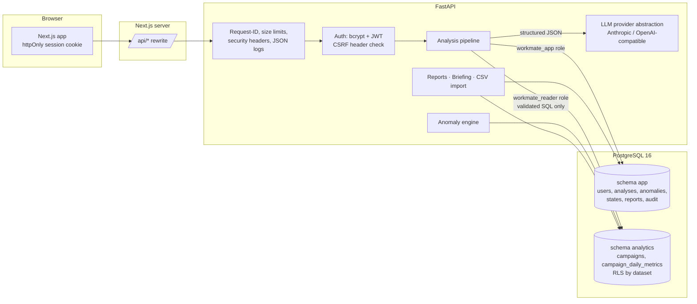

# System architecture

The browser only talks to the Next.js origin; `/api/*` is proxied to FastAPI. No API key, DB URL or prompt reaches the client.

## The analysis pipeline (`backend/app/pipeline/orchestrator.py`)

| Step | What happens | LLM mode | Demo mode |
|---|---|---|---|
| 1 Schema discovery | Approved tables/columns intersected with `information_schema`; metric definitions | same | same |
| 2 Interpretation | Question → `QuestionPlan` (intent, metrics, time preset, comparison, group-by, filters, ranking, clarification) validated by Pydantic; 1 retry on schema errors | LLM (forced tool / JSON-schema output) | keyword rules |
| — Period resolution | Presets → concrete dates against the anchor date; coverage check | code | code |
| 3 SQL generation | Must follow a *result contract* (exact columns, additive SUMs only, explicit date literals) | LLM | deterministic builder |
| 4 SQL validation | sqlglot AST checks (see SECURITY.md); executable SQL regenerated from the validated AST with an enforced LIMIT | same | same |
| 5 Execution | `workmate_reader`, read-only transaction, `statement_timeout`, `app.dataset_id` for RLS, row cap + truncation detection, audit log | same | same |
| 6 Result validation | Contract columns, numeric/negative/null checks, period labels, date range, duplicate keys (double counting), **independent totals cross-check** vs a deterministic query, coverage query | cross-check on | cross-check n/a (same builder) |
| ↺ Repair | Steps 3–6 retried up to `SQL_REPAIR_ATTEMPTS` (default 2) with the specific failure as feedback; validation is never bypassed | yes | no |
| 7 Calculations | Key metrics, changes, LMDI contributions, breakdowns, highlight rules, trend summaries → **facts** + chart specs + computed limitations | same | same |
| 8 Explanation | Draft must cite numbers as `{{fact_id}}` placeholders; sections: facts / contributions / hypotheses / actions / limitations | LLM | template narrator |
| 9 Response validation | Pydantic schema; placeholder ids must exist; literal numbers must match a fact (≤1% / rounding); causal words outside hypotheses warned. Failed LLM draft → 1 retry → deterministic fallback | yes | same checks |
| 10 Presentation | Persisted record: plan, SQL, validation report, capped result rows (≤500 aggregated rows), calculations, explanation, trace, LLM usage, timings, data-as-of | same | same |

Anomaly-scan questions skip steps 3–6 and read the stored detections of the statistical engine.

## Data model (schema `app`)

- `users` (bcrypt hash, reporting timezone, anomaly sensitivity, active dataset)
- `datasets` (owner or NULL = public synthetic; kind; timezone; stats; import summary)
- `analyses` (one row per investigation run; `parent_id` links re-runs/refinements)
- `anomalies` (detections per dataset; episode start/end; z; severity; data-quality status; detector version)
- `anomaly_states` (per-user triage status + note)
- `reports` (Markdown snapshots: investigation or briefing)
- `query_audit` (every SQL attempt: source, hash, validation result, executed, rows, ms, error)

## Key design decisions

- **Two DB roles, two pools.** The app role never runs model-generated SQL; the reader role can only SELECT two tables, filtered by RLS.
- **LLM writes additive SQL only; code does all ratios.** This removes a whole class of wrong-math answers and lets the app cross-check totals.
- **Facts, not numbers, in prose.** Narrative numbers are substituted from computed facts, so traceability is by construction rather than by best effort.
- **Demo mode shares steps 4–7 and 9.** The only things swapped are interpretation, SQL authoring and narration, so the safety and maths paths are exercised in every mode.

## Frontend

Next.js 16 App Router (client-rendered pages under `src/app/(app)`), Tailwind v4 tokens (light + dark), shadcn/ui components on Base UI, Recharts, lucide icons, IBM Plex Sans/Mono. Session via httpOnly cookie; `X-Requested-With: aiworkmate` on every call for CSRF protection.
