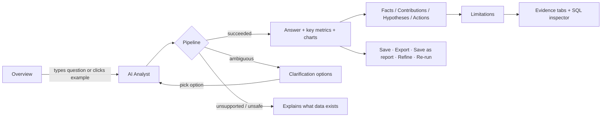

# User flows

## 1. Investigate a metric change (core flow)

1. User lands on **Overview** (greeting, freshness, KPI strip, 60-day chart, open anomalies, recent investigations).
2. Asks "Why did conversions fall last week?" in the ask bar or taps an example.
3. **AI Analyst** shows a loading state, then the investigation:
   - header: status, mode (LLM/Demo), synthetic badge, fresh vs stored, data-as-of;
   - **Answer** with fact chips (hover for the source fact);
   - **Key metrics** table (comparison, current, absolute and % change, direction-aware colours);
   - **Charts** (contribution bars + current vs comparison);
   - four labelled sections: observed facts, calculated contributions, possible explanations (dashed, with confidence), recommended actions;
   - **Limitations and assumptions**;
   - **Evidence** (periods, filters, segments, contribution table, raw rows);
   - **SQL inspector** (collapsed).
4. User saves, exports, saves as report, or refines the question.

## 2. Triage an anomaly

Overview → *Open monitor* → filter (e.g. severity High, platform Meta) → read observed vs expected range, deviation, z-score, data-quality flag → set status **Investigating** → *Investigate* opens AI Analyst with a question scoped to the anomaly's campaign and exact dates → after review, set **Resolved** or **Not actionable**. States persist per user.

## 3. Reopen and refresh

History → search / filter (status, saved only) → open → banner "You are viewing a stored result" (and, if the dataset has newer data, "re-run to refresh") → **Re-run on current data** creates a linked new investigation (`parent_id`).

## 4. Import a CSV

Data Sources → choose CSV → preview (rows, inferred types, missing counts, samples) → adjust column mapping → name dataset and reporting timezone → **Validate and import** → errors listed per problem (duplicates, non-numeric, negatives, clicks > impressions) or an import summary → **Use this dataset** → Overview/Analyst now query it. (The shared demo account can validate but not store uploads.)

## 5. Daily briefing

Reports → **Generate briefing** → deterministic summary (≥10% KPI moves, new anomalies, freshness/quality, campaigns to investigate, open items) → **Save briefing** → export.

## 6. First run without an API key

Login → *Continue with demo account* → banners on Analyst and Settings explain demo mode → Settings → AI model shows the env vars to set. Nothing is hidden or faked.
